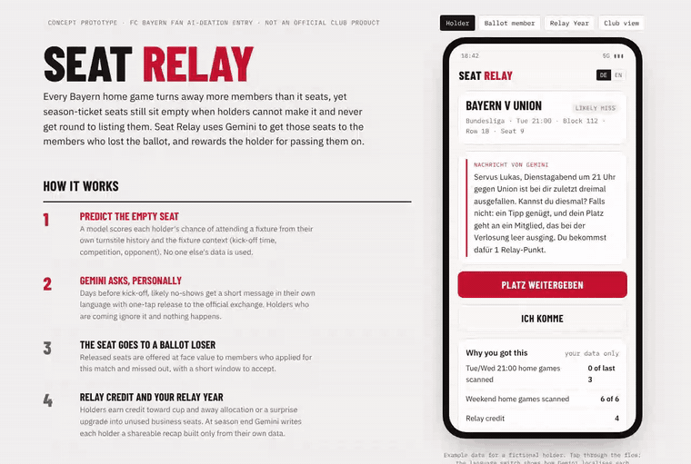
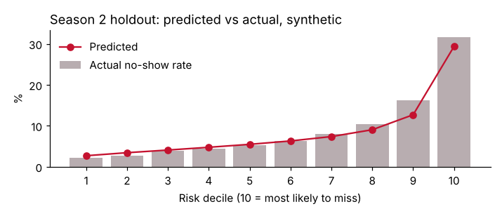

# Seat Relay

**Getting every empty season-ticket seat to a member who lost the ballot, and rewarding the holder who passed it on.**

Concept entry for the FC Bayern Fan AI-DEATION competition (Ticketing category). Independent work, not affiliated with or endorsed by FC Bayern München or Google.

**Live prototype:** https://rienhardtvane.github.io/seat-relay/



## The problem

Bayern home games are oversubscribed several times over. The club's CEO said in August 2026 that the Dortmund home game drew close to 350,000 ticket requests for a 75,000-seat stadium. Season-ticket seats still go empty when holders can't attend and don't list the seat. The official exchange gives no reward for listing, and business seats can't be listed at all.

## The idea

1. **Predict.** A model scores each holder's chance of missing a fixture, using only their own turnstile history and the fixture (day, kick-off time, competition, opponent).
2. **Ask.** Gemini messages likely no-shows in their own language, days before kick-off, with one-tap release to the official exchange and the real reason they were asked.
3. **Relay.** The seat goes at face value to a member who applied for that match and missed out.
4. **Reward.** The holder earns relay credit toward away and cup ballots, or an upgrade into unused business seats. At season end, Gemini writes each holder a shareable "Your Relay Year" recap from their own data.

The design follows a Bundesliga field experiment with 13,000+ season-ticket holders (ESSMA, April 2025): plain reminders had no measurable effect, a reminder plus a valuable incentive reduced no-shows, and holders who had attended 5 to 7 of the previous 13 matches responded most. Brentford's "Every Seat Counts" scheme lifted season-ticket seat use from 90% to 96% with a release deadline and account credit (Brentford FC, January 2025).

## What's in this repo

| Path | What it is |
|---|---|
| `index.html` | Clickable prototype: holder nudge, ballot-member offer, Your Relay Year, club capacity view, with a DE/EN switch |
| `model/seat_relay_model.ipynb` | No-show model and targeting simulation on synthetic season-ticket data |
| `model/synth.py` | Synthetic data generator and pre-kick-off feature engineering |
| `prompts/nudge_prompt.md` | The Gemini prompt: structured payload in, grounded message out |

## Model results (synthetic data)

4,000 synthetic holders across two seasons of 22 home fixtures each. Trained on season 1, tested on season 2.

| | |
|---|---|
| Logistic regression, holdout AUC | 0.75 |
| Share of season 2 empty seats in the top risk decile | 35% |
| Seats relayed per 100 nudges, nudging everyone | 3.3 |
| Seats relayed per 100 nudges, nudging the top 15% by risk | 12.7 |

I chose logistic regression over gradient boosting (AUC 0.755) because the gap is small and every driver can be explained to a fan or a data protection officer.



**Every number above comes from synthetic data and stated assumptions.** FC Bayern publishes no no-show rate, season-ticket count or exchange volume. The behavioural parameters (unprompted release rate, response to an incentive) are named at the top of the simulation so they can be replaced with real figures. The notebook shows the method, not the size of the prize.

## Guardrails

- Opt-in only.
- Reward-only: the score unlocks credit and upgrades, and never feeds cancellations, sanctions or attendance-minimum checks (GDPR Article 22).
- Own data only: no seat neighbours, friends or any other fan's behaviour.
- Recipients are shown as "a member", never by name.
- A data protection impact assessment before any launch.

## Run it

```bash
pip install -r requirements.txt
cd model && python build_notebook.py   # regenerates and executes the notebook
```

Or open `index.html` in a browser.

## About

Built by Rienhardt van Eeden: football business and data, previously CRM, ticketing and fan data at STVV (Belgian Pro League), with an FBA Master's in Football Business. [LinkedIn](https://www.linkedin.com/in/rienhardtvane)
